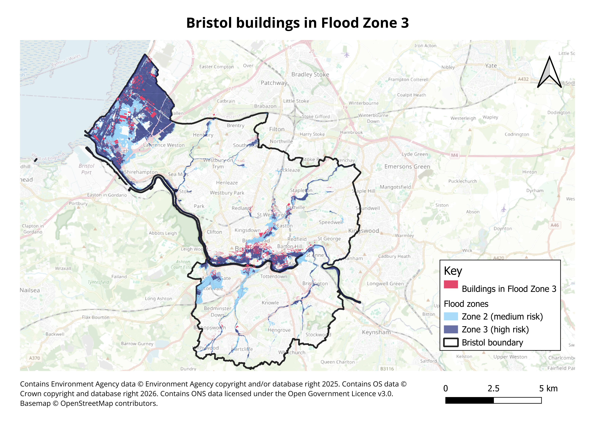
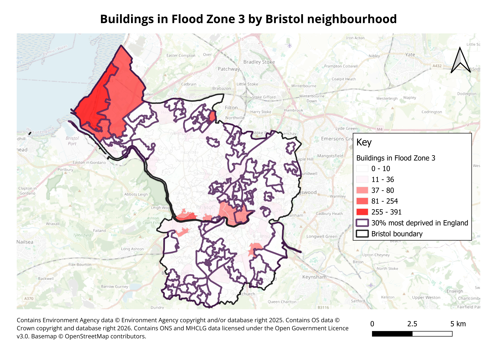

# An Analysis of Bristol’s Flood Exposure Using QGIS
Mapping of Bristol buildings and neighbourhoods to understand their exposure to fluvial and tidal flooding, today and with climate change. 

[Read the full analysis (PDF)](https://github.com/sara-sari/Bristol-flood-exposure/blob/main/Bristol%20Flood%20Analysis.pdf)
## Key findings
-	**2,319 buildings (4.2% of Bristol’s buildings)** lie in Environment Agency’s Flood Zone 3, the highest-risk zone. 
-	Flood risk is concentrated in **Avonmouth** and **Bristol city centre**. Three Avonmouth neighbourhoods alone contain about a third of Bristol’s Zone 3 buildings. 
-	Four of the five neighbourhoods with the most at-risk buildings by number are among the **30% most deprived in England**. 
-	With climate change, a further **1,059 buildings** could be at risk, an increase of **24%**. 
-	The hotspots align with two of Bristol’s major flood schemes (the ASEA flood defences and the Bristol Avon Flood Strategy), although clusters along smaller rivers, such as Eastville, lie outside both. 

## Method
-	Clipped Environment Agency Flood Zones (2025) and OS OpenMap – Local buildings to the Bristol boundary in QGIS 3.44
-	Counted buildings in Flood Zones 2 and 3 using spatial queries 
-	Summarised results by neighbourhood (LSOA) and joined the English Indices of Deprivation 2025
-	Repeated the analysis using the EA’s Flood Zones plus Climate Change layer 
-	Compared results with Bristol City Council’s findings and the Bristol Avon Flood Strategy 
## Data
Environment Agency, Ordnance Survey, ONS and MHCLG data, licensed under the Open Government Licence v3.0. Basemap © OpenStreetMap contributors. 
## Acknowledgements
I carried out all the analysis and mapping in QGIS myself. I used Claude (by Anthropic) as a learning guide while developing my GIS skills and for feedback on the analysis and writing. 
## Author
Sara Sari, BSc Geography ∙ November 2026
